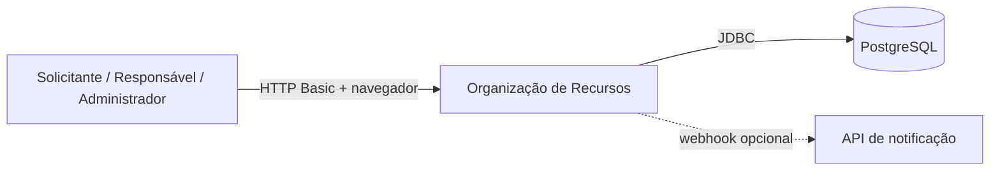
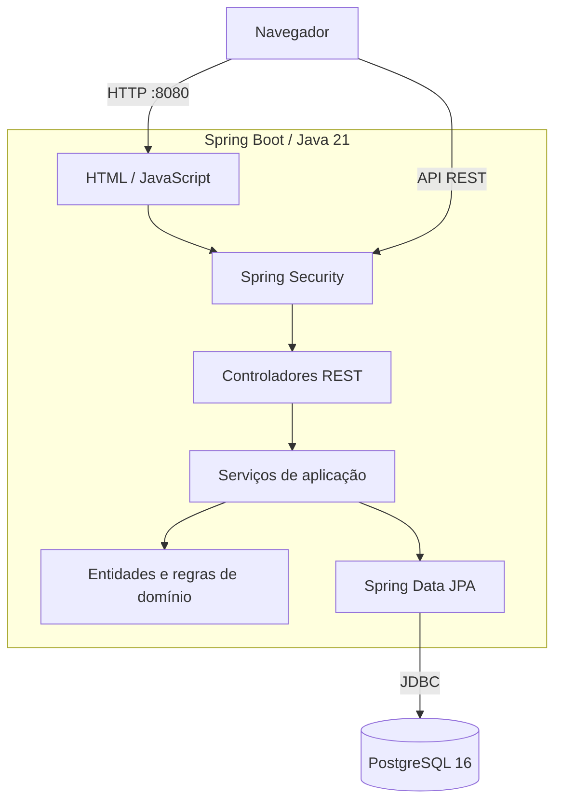

# Arquitetura e operação

## Visão geral

Aplicação monolítica Spring Boot 3.3 / Java 21. A interface HTML/JavaScript é servida pela aplicação; controladores REST delegam regras para serviços; Spring Data JPA persiste no PostgreSQL. Spring Security aplica HTTP Basic stateless, com usuários e papéis persistidos. Flyway controla o schema por migrações SQL.

## C4 — contexto (nível 1)

## C4 — contêineres (nível 2)

## Componentes e sequências

Ver [docs/DIAGRAMAS-SEQUENCIA.md](DIAGRAMAS-SEQUENCIA.md), que contém o diagrama de componentes e as sequências de solicitação, aprovação restrita e retirada/devolução.

## Regras de domínio

- Intervalos semiabertos `[início, fim)`: períodos adjacentes não conflitam.
- Reserva pode vincular recurso principal e professor; ambos são bloqueados em ordem crescente de ID para reduzir deadlocks.
- A consulta de conflitos considera o recurso como principal ou professor vinculado.
- Reserva nova começa em SOLICITADA; somente RESPONSAVEL pode aprovar quando o recurso principal ou professor for restrito.
- Apenas reservas SOLICITADAS podem ser reagendadas; a operação repete a validação de disponibilidade.
- Solicitante só altera/cancela suas próprias reservas; RESPONSAVEL/ADMINISTRADOR têm permissão de gestão conforme o endpoint.
- Retirada exige reserva de MATERIAL aprovada; devolução registra responsável/data e conclui a reserva.
- Criação, transições, cancelamento e reagendamento geram auditoria; o login autenticado é registrado como origem.
- Conflitos recusados são persistidos em transação independente para alimentar relatórios mesmo quando a transação da reserva sofre rollback.
- Notificações são persistidas como SIMULADO; se `NOTIFICACAO_URL` estiver configurada, o serviço envia webhook HTTP e registra canal HTTP.

## Perfis e responsabilidades

| Perfil | Permissões principais |
|---|---|
| SOLICITANTE | Consultar recursos/reservas, solicitar reserva, reagendar/cancelar a própria reserva |
| RESPONSAVEL | Consultar, aprovar reservas restritas, transicionar estados, retirar/devolver materiais, consultar relatórios e notificações |
| ADMINISTRADOR | Gerenciar recursos/usuários, consultar e gerenciar reservas e relatórios; não substitui o papel RESPONSAVEL para aprovar recurso restrito |

## Endpoints principais

| Método | Caminho | Permissão |
|---|---|---|
| GET | `/recursos` | autenticado |
| POST / PUT | `/recursos`, `/recursos/{id}` | ADMINISTRADOR |
| GET / POST | `/reservas` | autenticado |
| PUT / DELETE | `/reservas/{id}` | titular ou perfil privilegiado |
| PATCH | `/reservas/{id}/estado` | RESPONSAVEL/ADMINISTRADOR; restrição em sala, professor ou material exige RESPONSAVEL |
| POST | `/reservas/{id}/retirada`, `/devolucao` | RESPONSAVEL/ADMINISTRADOR; reserva de um único material |
| POST | `/reservas/{id}/materiais/{materialId}/retirada`, `/devolucao` | RESPONSAVEL/ADMINISTRADOR; material associado à reserva |
| GET | `/reservas/movimentacoes` | RESPONSAVEL/ADMINISTRADOR |
| GET | `/reservas/{id}/auditoria` | autenticado |
| GET / POST / PATCH | `/usuarios`, `/usuarios/{id}/ativo` | ADMINISTRADOR |
| GET | `/relatorios/**`, `/notificacoes` | RESPONSAVEL/ADMINISTRADOR |

Contrato interativo: `/swagger-ui/index.html`; documento OpenAPI: `/v3/api-docs`.

## Execução local

1. Instale JDK 21, Maven 3.9+ e Docker.
2. Copie `.env.example` para `.env`; defina DB_PASSWORD e credenciais do administrador inicial (senha com pelo menos 12 caracteres).
3. Execute `docker compose up --build -d`.
4. Acesse `http://localhost:8080` e autentique-se com APP_ADMIN_USERNAME/APP_ADMIN_PASSWORD.
5. Cadastre perfis SOLICITANTE e RESPONSAVEL pela API `/usuarios`.
6. Consulte logs com `docker compose logs -f app`; encerre com `docker compose down`.

As portas são publicadas somente em localhost. HTTP Basic deve ser usado somente em localhost ou protegido por HTTPS em outro ambiente.

## Banco de dados e migrações

Flyway executa as migrações SQL versionadas `V1` a `V9` (a `V9` libera movimentações por material sem remover registros antigos); Hibernate usa `ddl-auto: validate`. Para banco existente sem histórico Flyway, a configuração baseline version 1 preserva o schema anterior e aplica as migrações incrementais. A V2 cria índice único normalizado; se o banco legado contiver nomes duplicados, faça backup e resolva-os antes da migração, seguindo `LEIA-PRIMEIRO-DUPLICADOS.md`.

## Testes

Execute `mvn clean verify`. Testcontainers requer Docker. Relatório JaCoCo: `target/site/jacoco/index.html`. Estratégia: [PLANO-DE-TESTES.md](PLANO-DE-TESTES.md). Teste de carga: [PLANO-TESTE-CARGA.md](PLANO-TESTE-CARGA.md).

## Limitações restantes

- Metas de 80% linhas e 70% branches ainda precisam ser medidas e comprovadas; o pipeline não deve ser considerado aprovado até o último commit passar.
- SonarCloud requer configurar SONAR_TOKEN (secret) e SONAR_ORGANIZATION / SONAR_PROJECT_KEY (variables) no GitHub.
- JMeter tem plano/script, mas não resultado de execução anexado.
- E2E automatizado cobre API real + banco; não há automação de navegador.
- Responsividade precisa de checklist manual e evidência em dispositivos/viewport.
- Auditoria de alterações cadastrais de recursos/usuários pode ser ampliada.
- Backup, restauração, monitoramento e hardening HTTPS são atividades pré-produção.

Este sistema é uma entrega acadêmica em evolução; não expor publicamente nem utilizar dados operacionais reais sem revisão de segurança e operação.
