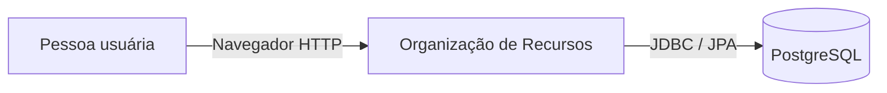
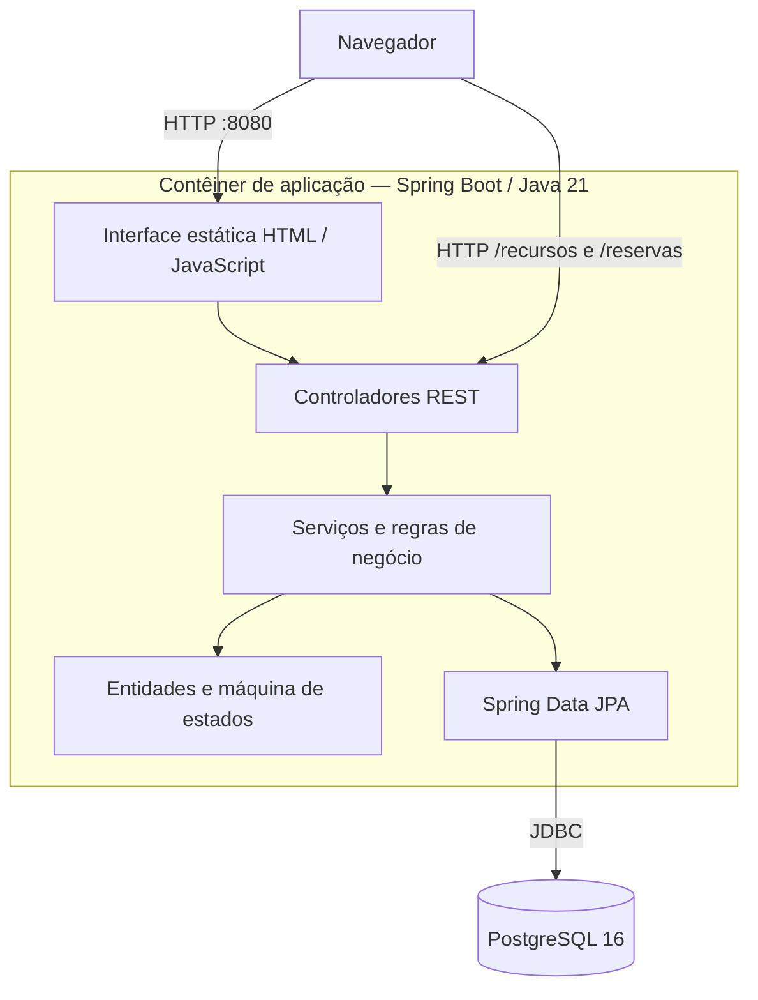

# Arquitetura e operação

## Visão geral

O sistema é uma aplicação monolítica Spring Boot. A interface web estática é servida pela própria aplicação; a API REST aplica as regras de negócio; Spring Data JPA persiste os dados em PostgreSQL.

## Diagrama de contexto (C4 — nível 1)

## Diagrama de contêineres (C4 — nível 2)

## Regras de domínio observáveis no código

- Reservas usam intervalos semiabertos `[início, fim)`: dois períodos adjacentes não se sobrepõem.
- A criação bloqueia a linha do recurso com lock pessimista antes de consultar conflitos, serializando solicitações concorrentes para o mesmo recurso.
- Mudanças de estado bloqueiam a linha da reserva e respeitam as transições definidas em `EstadoReserva`.
- A criação e cada transição persistem um evento em `reserva_auditoria` na mesma transação.
- A auditoria atual registra a origem técnica `API`, não a identidade de uma pessoa.
- Recursos em manutenção não podem receber novas reservas.
- O nome de recurso é validado sem diferenciar maiúsculas/minúsculas e espaços nas extremidades, por tipo.

## Endpoints implementados

| Método | Caminho | Responsabilidade |
|---|---|---|
| GET | `/recursos` | Listar recursos |
| POST | `/recursos` | Cadastrar recurso |
| PUT | `/recursos/{id}` | Atualizar nome, restrição e manutenção |
| GET | `/reservas` | Listar reservas |
| POST | `/reservas` | Solicitar reserva |
| PATCH | `/reservas/{id}/estado` | Transicionar estado |
| GET | `/reservas/{id}/auditoria` | Consultar histórico |

## Execução local

1. Instale JDK 21, Maven 3.9+ e Docker.
2. Copie `.env.example` para `.env` e defina uma senha local forte em `DB_PASSWORD`.
3. Execute `docker compose up --build -d`.
4. Acesse `http://localhost:8080`.
5. Consulte logs com `docker compose logs -f app`.
6. Encerre com `docker compose down`. Isso preserva o volume do banco.

## Testes

Execute `mvn clean verify`. Os testes de integração usam PostgreSQL real por meio do Testcontainers e exigem Docker. O relatório JaCoCo fica em `target/site/jacoco/index.html`.

## Limitações e riscos conhecidos

- Não há autenticação nem autorização. A aplicação não deve ser exposta publicamente nem usada com dados reais.
- Não há fluxo de aprovação por perfil para recursos restritos.
- Não há identificação do usuário na auditoria.
- Não há operações de retirada/devolução de materiais.
- Não há edição de período de reserva.
- O schema ainda é gerenciado por `spring.jpa.hibernate.ddl-auto=update`; não há migrações versionadas.
- A matriz integral dos 14 requisitos não pode ser concluída sem o enunciado oficial do trabalho.

## Recomendações antes de produção

Implementar autenticação/autorização e políticas de acesso, introduzir migrações de banco revisadas, definir backup e recuperação, adicionar testes ponta a ponta e de carga, revisar segredos e configurar observabilidade. A configuração Docker local é para desenvolvimento/demonstração, não uma implantação de produção.
