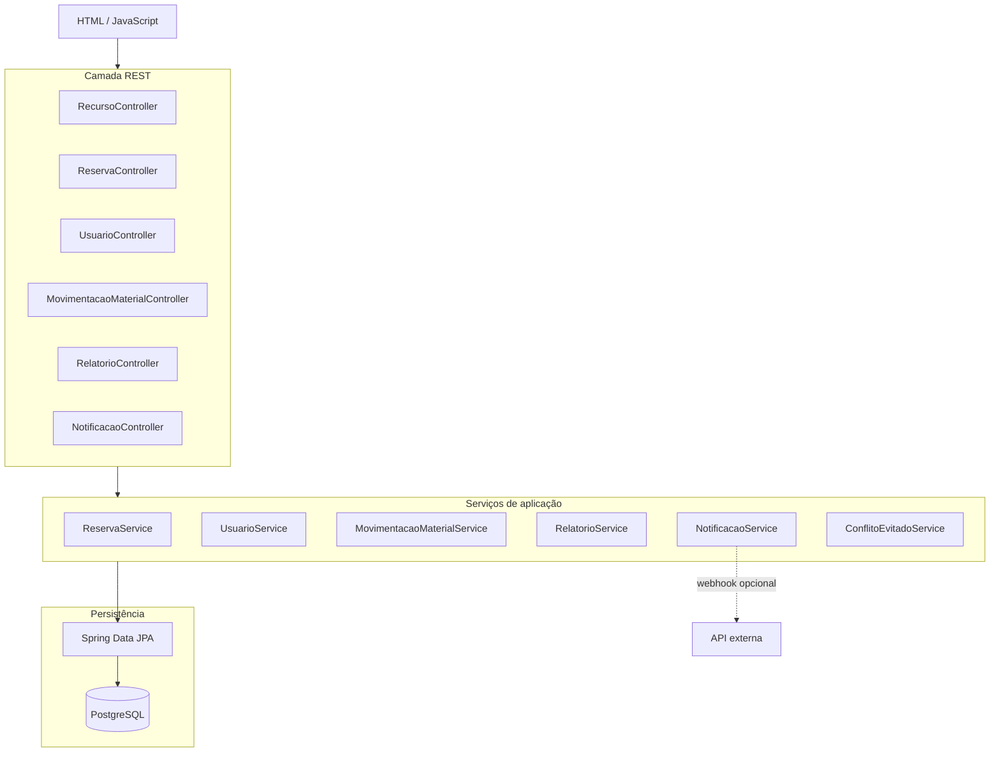
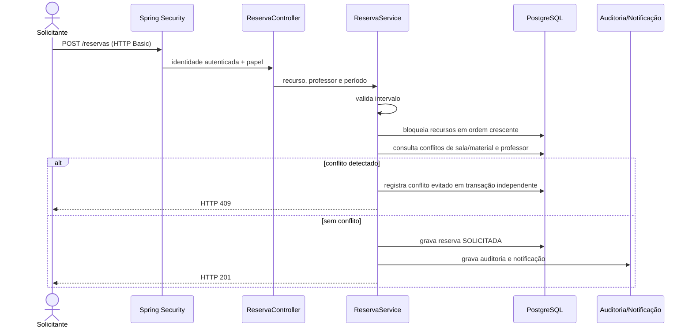
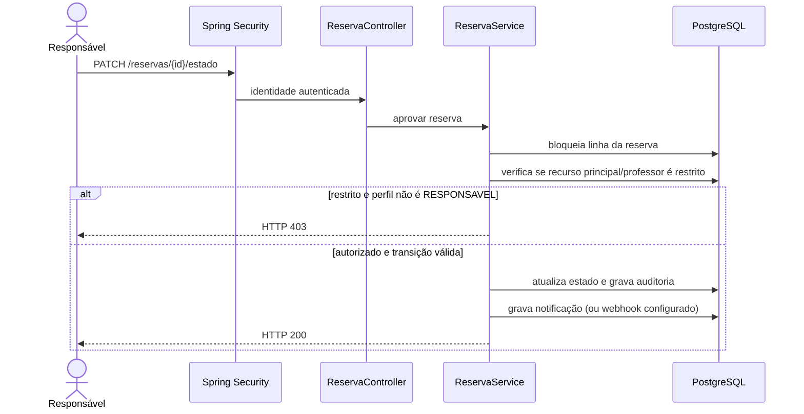
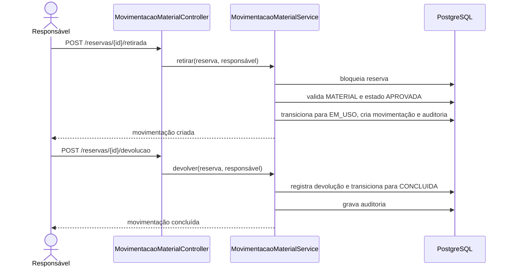

# Diagramas de componentes e sequências críticas

## Componentes (C4 — nível 3 simplificado)

## Sequência — solicitação de reserva com professor

## Sequência — aprovação de recurso restrito

## Sequência — retirada e devolução

